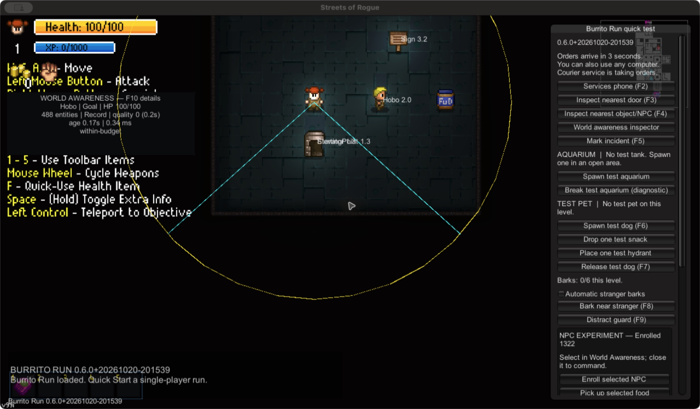

# Burrito Run — Streets of Rogue NPC experiments and tools

## ELI5: What are we trying to make?

**Give the people in Streets of Rogue more reasons to do things with each other.**

Imagine ordering a burrito in a city where everybody has somewhere to be.

The courier would like to finish the delivery. Someone nearby would very much
like a burrito. A third person needs a favor, preferably right now. Each of them
has a perfectly reasonable plan. Unfortunately, their plans involve the same
courier, the same doorstep, and rather more burritos than are available.

That is the sort of small, untidy story this project wants to make possible.
The full scene above is an ambition, and there is plenty left to build.

NPCs are the characters controlled by the game. The original idea was to give
them more things to want, use, offer and react to, then let those simple rules
meet in the street. A favor could become an inconvenience. An ordinary delivery
could become somebody's very strange afternoon. The player could help, meddle,
or stand a little way back and see how everyone gets on.

**What exists today:** small working experiments with burrito delivery, a banana
favor with two possible rewards, and one character choosing which food to pick
up. There are also earlier dog and aquarium experiments, because a neighborhood
can always use a dog and a questionable piece of furniture.

Along the way, we built tools to see what characters are doing, explain their
choices, and check whether an action really worked. It helps to know whether
someone actually collected the food before congratulating them on their lunch.
The details and remaining limits are below.

**Where the goal stands now:** the next step is richer interaction **between
characters**, including situations the player can simply observe. Development
is paused while we compare ways to support that goal. We have learned enough
from these experiments to ask better questions about what comes next. The code,
tools and discoveries are staying here for anyone who can use them.

**Why share it:** you might be building a mod, wondering how the game's
characters work, or carrying a different idea altogether. There may be something
useful here for you. We have left notes about what worked, what surprised us,
and what still needs figuring out. You are welcome to pick up a useful piece
and take it somewhere new.

The current experiments use ordinary rules and calculations. Running them
does not require an AI model or an online service.

## Technical overview

The current implementation is a BepInEx/Harmony prototype for **Streets of
Rogue 1**. It uses the installed game's characters, items and movement systems.

**Add-on only:** players need their own installed copy of Streets of Rogue 1.
Workshop distribution is an intended target; the current implementation loads
through BepInEx. This ZIP is a developer source package, and a subscribe-to-install
Workshop route for the code plugin has not been verified.

The reusable tooling includes a spatial world index,
perception/navigation inspection, bounded capture, independent report readers,
deterministic NPC decisions and replay, and disposable native test fixtures.

**Project status, October 20, 2026:** paused for a platform reassessment. The
current prototype provides building blocks for the larger goal. General
NPC-to-NPC social behavior remains future work.

## What is worth exploring

| Piece | What you can learn or reuse | Evidence and limits |
| --- | --- | --- |
| World Awareness | Nearby entities, activation identities, range filters, LOS/cone/camera distinctions, goal/path inspection | Native fixtures and developer-host benchmarks; sampled observations, incomplete release/performance coverage |
| NPC decisions and replay | Pure preference-minus-distance choices, commitments, native-obligation precedence, versioned captures | One explicitly enrolled native `Hobo` (Slum Dweller), Fud/Banana pickup and retention; autonomy off by default |
| Native action ownership | Bound an action, yield to recruitment/jobs/danger, preserve a newer command | Controlled pickup/replacement/release tests; ordinary food/recruitment playcheck remains incomplete |
| Evidence tooling | Detached recording, independent readers, negative controls, inventory/ground-state checks | Replay proves a policy result; fixtures prove particular native paths; neither proves fun |
| Banana favors | Native menus and speech, one shared banana, competing $15 / First Aid Kit rewards | Cash route received a human playcheck; kit route has automated native evidence |
| Earlier experiments | Courier delivery, reputation, entrance/door diagnostics, dog interests, aquarium effect | Preserved with observations and gaps; see [the experiments, in order](docs/experiments/README.md) |



Actual development capture, not a mockup. The fixture owns its actors; the UI
is developer tooling. [Gallery and provenance](docs/screenshots.md).

## Start here

New here? The [documentation map](docs/README.md) goes from this page down to
the source in five steps, and [the experiments, in order](docs/experiments/README.md)
tells the story of the three weeks of work. Or jump straight to a goal:

| Your goal | Read |
| --- | --- |
| Build or try it | [Setup, launch and troubleshooting](docs/getting-started.md) |
| Understand the code | [Architecture and source map](docs/architecture.md) |
| Find a known method and its caveats | [Project and native method reference](docs/reference/methods.md) |
| Assess what works | [Current state and evidence limits](docs/current-state.md) |
| Understand the pause and possible directions | [Ethos, parked ideas and future questions](docs/ethos-and-future.md) |
| Contribute with a person or coding agent | [CONTRIBUTING](CONTRIBUTING.md), [AGENTS](AGENTS.md), [extension workflow](docs/reference/extending.md) |
| Browse the original investigations | [Experiments timeline](docs/experiments/README.md), [history](docs/history/README.md) |
| Prepare a GitHub upload | [Source publication guide](docs/maintainers/publishing.md) |

### Repository layout

```text
README.md, CONTRIBUTING.md, AGENTS.md   start here / contributing / AI-agent rules
*.command                               double-click launchers (macOS)
Makefile, scripts/                      build, launch, in-game test harnesses, report readers
src/BurritoRun/                         the BepInEx plugin (C#)
src/BurritoRun.Profile/                 keeps prototype saves apart from your normal saves
tests/, tools/InspectGame/              offline checks; read-only game assembly inspector
docs/                                   documentation, see docs/README.md
  experiments/01-04                     one folder per experiment, in the order built
  reference/  maintainers/  history/    lookup tables / packaging / dated working notes
```

## Build and verification

The existing toolchain is **macOS, .NET SDK 7, a locally owned game install,
and BepInEx 5.4.23.5**. The plugin targets .NET Framework 4.7.2. This is a
developer source release; Windows/Linux and clean-machine installation have
not been verified. See setup instructions for installation paths before
running these commands from the repository root.

### Dependencies

Installation paths live in [GamePaths.props](GamePaths.props), shared by the
plugin build, linked tests and launcher. Defaults use your current user's home
directory and the standard macOS Steam library; no source edits are needed there.
For another Steam library, export its absolute game-folder path before building
or launching:

```sh
export GameDir="/Volumes/Games/SteamLibrary/steamapps/common/Streets of Rogue"
bash scripts/game-paths.sh                # show the resolved installation paths
```

Keep that variable exported in the terminal used for setup/checks/launching.
`SOR_GAME_APP`, `ManagedDir`, and `SOR_ORIGINAL_PROFILE` can independently override
the app/executable, managed-library folder, and original CloudData folder.
For Finder double-click launchers, edit the defaults in `GamePaths.props` if your
game is outside the standard library. See [setup](docs/getting-started.md#prerequisites-and-paths)
for details. This centralizes paths; the loader still targets macOS.

The runtime dependencies below are not checked in. A fresh clone gets the loader from `setup.sh`;
the game's own libraries always come from your installed copy of the game.

| Dependency | Used for | Where it comes from | Where the build looks |
| --- | --- | --- | --- |
| Streets of Rogue 1 (Steam) | The game being modded | Buy and install it yourself | `GameDir` (see [getting started](docs/getting-started.md)) |
| Game libraries: `Assembly-CSharp`, `UnityEngine.*`, `Mirror`, `Newtonsoft.Json` | Compiling against the game's code | Your game install. Never downloaded or redistributed | `ManagedDir` from `GamePaths.props` |
| BepInEx 5.4.23.5 (macOS universal) | Loads the plugin into the game | `bash scripts/setup.sh` downloads it from the [BepInEx GitHub release](https://github.com/BepInEx/BepInEx/releases/tag/v5.4.23.5) and checks its SHA-256 | `.tools/loader/BepInEx/core/` |
| HarmonyX (`0Harmony.dll`) | Patching game methods at runtime | Inside the BepInEx archive | `.tools/loader/BepInEx/core/` |
| Mono.Cecil | Profile patcher (keeps prototype saves separate) and `tools/InspectGame` | Inside the BepInEx archive | `.tools/loader/BepInEx/core/` |
| `Microsoft.NETFramework.ReferenceAssemblies` 1.0.3 | Building `net472` on macOS | NuGet, restored automatically by `dotnet` | `.tools/nuget/` |
| .NET SDK 7, Python 3, bash, make | Build, checks and report scripts | Install yourself (`dotnet --list-sdks` should show 7.x) | Your `PATH` |

If `curl` is blocked, download `BepInEx_macos_universal_5.4.23.5.zip` from the
release page yourself, put it in `.tools/downloads/`, and rerun
`bash scripts/setup.sh`: it skips the download and still checks the hash. A
build that fails with dozens of `HarmonyLib` / `BepInEx` / `Mono` "could not be
found" errors means `.tools/loader/` is missing; run setup.

```sh
bash scripts/setup.sh                    # downloads verified loader; builds/installs
make check                               # build/analyzers/format; no install
bash scripts/test-routing.sh              # linked C# policies and replay checks
python3 -m unittest discover -s tests -p 'test_*.py'
```

Close the game before setup, `make build`, or native harnesses. `make build`
copies DLLs into the local loader. `make npc-desires`, `make banana-quest`, and
`make world-harness` launch disposable-profile suites and save reports under
ignored `.runtime/`. Longer suites are listed by `make help`.
See [validation boundaries](docs/current-state.md).

## Scope and reuse

Most plugin types are internal and coupled to this game; there is no stable
external SDK. Pure policies and Python readers are easier starting points for
reuse. Native goal names alone do not establish complete actions or portable
APIs. Multiplayer, hunger/eating for the enrolled civilian, bargaining, social
memory and general autonomous NPC-to-NPC relationships are not implemented.

A [small native decision capture](docs/examples/README.md) is included for
inspection and offline replay without the private run directory.
Key functions also have human-readable headers explaining their purpose and
the reasons behind ownership, timing, safety and evidence constraints.

Original code and documentation use the [MIT license](LICENSE). Streets of
Rogue and its artwork belong to their respective owners. Game assemblies,
saves and downloaded dependencies are excluded from the source bundle;
see [third-party notices](THIRD_PARTY_NOTICES.md).
The [distribution audit](docs/maintainers/distribution-audit.md) records the actual ZIP checks
and the boundary between the source package and a future player/Workshop release.

The [previous development README](docs/history/2026-10-20-development-README.md)
retains legacy controls and dated observations. Historical “next steps” are
research history, not the current work queue.
