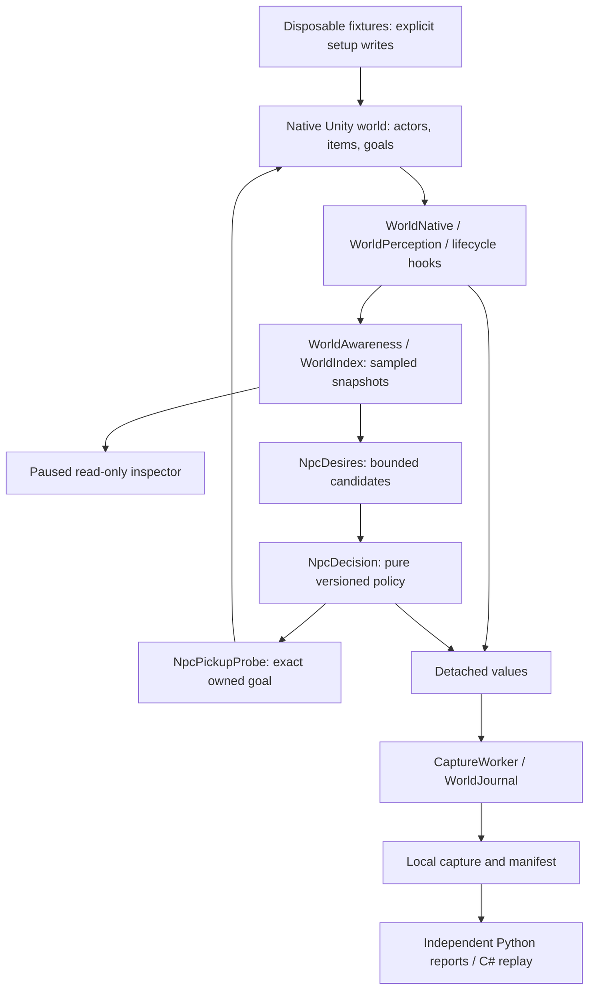

# Architecture and source map

The project separates observing the native game, deciding in detached data,
executing a bounded native action, and checking resulting state. Most classes
are internal; the tables describe contributor seams, not a supported SDK.

## Source responsibilities

Paths below are relative to `src/BurritoRun/` unless stated otherwise.

| Area | Files | Responsibility / boundary |
| --- | --- | --- |
| Entry/config/UI routing | `Plugin.cs`, `Patches.cs`, `TestPanelInput.cs` | BepInEx lifecycle, flags/config, Harmony hooks, developer controls/input handling |
| Profile separation | `../BurritoRun.Profile/ProfilePatcher.cs` | Cecil rewrites persistentDataPath call sites in memory; requires an absolute profile path |
| Detached world model | `WorldModels.cs`, `WorldIndex.cs` | Entity/query/perception records, spatial filtering, deterministic ordering, quality accounting |
| Live observation | `WorldAwareness.cs`, `WorldNative.cs`, `WorldPerception.cs`, `WorldLifecycleHooks.cs` | Rolling census, native detail, pooled identity/retirement, LOS/camera/navigation evidence |
| Inspection | `WorldAwarenessUI.cs`, `WorldInspector.cs`, `DoorwayInspector.cs` | Paused rich inspector, legacy nearest snapshot, doorway grid; selection is not a command |
| Capture | `CaptureWorker.cs`, `WorldJournal.cs`, `TraceStorage.cs`, `TraceWorld.cs`, `BarkTrace.cs` | Bounded detached serialization/writing, manifests, history, loss/closure and legacy traces |
| Measurement | `WorldBenchmark.cs`, `WorldReadiness.cs`, `SampledApproach.cs` | Comparable trials, overload/recovery evidence, matched-goal movement segments |
| NPC policy | `NpcDecision.cs` | Pure candidate validation/scoring and versioned precedence; no Unity calls |
| NPC live adapter | `NpcDesires.cs` | At most 16 nearby food candidates, 0.4-game-second decisions, sampled inspection/capture |
| NPC execution | `NpcPickupProbe.cs` | Canonical Hobo enrollment, live eligibility, native pickup, exact goal ownership and safe cancellation |
| Favor content | `QuestPolicy.cs`, `QuestStartWindow.cs`, `BananaEncounter.cs`, `QuestService.cs` | Pure objective, stable startup window, native placement, menus/exact exchange/reward/tracker |
| Delivery | `DeliveryRoute.cs`, `DeliveryDestination.cs`, `DeliveryService.cs`, `CourierDoorInteraction.cs`, `CourierLoadout.cs`, `CustomerReputation.cs` | Route policy, exterior handoff selection, native courier, knocking, equipment and run-scoped safety flags |
| Legacy presentation/scenarios | `ServicesPhone.cs`, `TestDiagnostics.cs`, `TestScenarios.cs` | IMGUI Services shell and handoff/recovery diagnostics |
| Parked dog work | `PetPolicy.cs`, `PetService.cs`, `PetLevelScope.cs`, `PetFoodFixture.cs`, `PetHydrantPolicy.cs`, `PetHydrantService.cs`, `PetBarkPolicy.cs`, `PetBarkService.cs` | Courier visual proxy, level scope, bounded interests and native noise; fixture setup stays separate |
| Parked aquarium | `AquariumService.cs`, `AquariumScatter.cs` | Table-backed visual prop and bounded scatter policy |
| Native fixtures | `WorldFixture.cs`, `WorldHarness.cs`, `WorldAwarenessHarness.cs`, `NpcDesireFixture.cs`, `NpcProbeHarness.cs`, `NpcDesireHarness.cs`, `QuestHarness.cs`, `Pet*Harness.cs`, `PetHydrantFixture.cs` | Owned disposable setup, real native API calls, interruption/lifecycle cases; intentionally mutating |
| Native inspection CLI | `tools/InspectGame/Program.cs` (repository root) | Read installed assemblies with Mono.Cecil without running the game |
| Offline verification | `tests/DeliveryRoute.Tests/`, `scripts/report*.py`, `tests/test_*.py` (repository root) | Linked pure source, replay envelopes and independent report regressions |

## Contracts that matter

**Identity and age:** a native UID alone is insufficient for pooled objects.
World snapshots include level, instance/activation identity and observation time.
Resolve and revalidate a live target immediately before acting. A lifecycle-core
record can precede detailed classification/perception; it is not complete knowledge.

**Perception:** geometry LOS, cone, range, camera bounds and actual native sensory
behavior answer different questions. A nearby tile can be walkable while the
route is blocked. Native goals describe intent; inventory gain/ground retirement
and measured movement establish outcomes.

**Ownership:** a pickup owns one exact root goal instance and its GoHere fields.
Recruitment, employment, following, emergencies and newer commands can supersede
it. Cleanup preserves replacements, even an identical-destination GoHere command.

**Threads and budgets:** native reads remain on the main thread. Detached
primitive/list/dictionary payloads go to one bounded writer. Queue loss, disk
rotation, deferred detail and incomplete closure remain visible. See
[world contracts](../WORLD_AWARENESS_ARCHITECTURE.md) and [capture fields](../LOGGING.md).

**Reuse elsewhere:** begin with the pure policies, data contracts, independent
readers and fixture/report pattern. Live adapters reference Unity, SoR native
roles/goal semantics and plugin services. They need replacement for another
engine; copying them does not create a portable NPC SDK.
