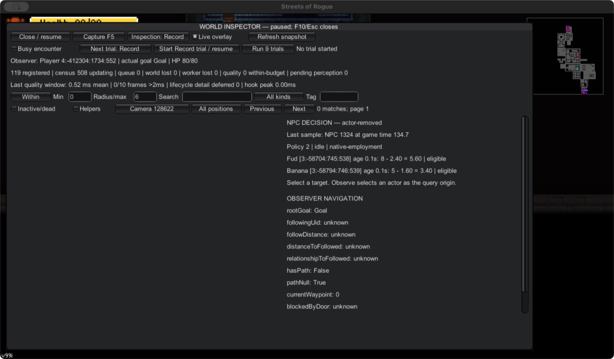
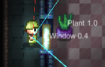

# Screenshots and provenance

> **What this is:** Real in-game captures of the developer tools, with where and when each was taken.  
> **Read it if:** You want to see what the tools look like without building anything.  
> **Status:** Current as of October 20, 2026.

These are actual game/tool captures, not generated illustrations. The current
screenshots come from a disposable native fixture. Fixture-owned NPCs/items and
developer panels are visible; this is not a claim of ordinary-play acceptance.
The underlying game artwork retains its third-party ownership.

## World overlay and command panel

Captured October 20, 2026, build `0.6.0+20261020-201539`, session `8c32ec38`.
The spatial overlay labels actors/items and draws range/facing evidence. The
right-hand developer panel exposes explicit commands. A displayed entity count
or tiny work-time sample is diagnostic evidence, not a performance guarantee.

## Paused world and decision inspector

Same build/session, at the fixture's final inspection window. This view exposes
sampled identity/state, query controls and the last deterministic decision.
Pause, sample age and candidate rejection matter when interpreting it. The
capture is a UI example; the independent report checks native outcomes.
Here the suite has reloaded the level: the panel explicitly says `actor-removed`
and shows the previous sample's `native-employment` inhibition. It is retained
diagnostic history, not an enrolled actor or current-world food query.

## Earlier damaged-window observation

Preserved October 4 setup image for session `8fc5165e`, incident 8166,
from the original local `visibility-8fc5165e-damaged-window-setup.png`.
It illustrates the difference between nearby/rendered targets and native geometry
LOS. The related observation recorded blocked LOS in that setup; it does not
prove all windows block sight, identify the exact hit collider, or establish
witness attribution. See [original validation](experiments/01-world-awareness/validation.md).

## Capture method

New images were saved directly from the native application screenshot API.
No AI-generated replacement or composited gameplay is used. The older detail
image is copied unchanged. Build/session names and SHA-256 image receipts are
recorded in the [publication check](maintainers/publication-check.md).

The game and private runtime directories are not part of the source bundle.
To reproduce the tools view, follow [setup](getting-started.md), then use
`make npc-desires` with the game closed. Its final inspector is open briefly
before the automatic suite closes and quits. Screenshots complement the evidence
reader; they cannot replace inventory/ground-state or command-preservation checks.
